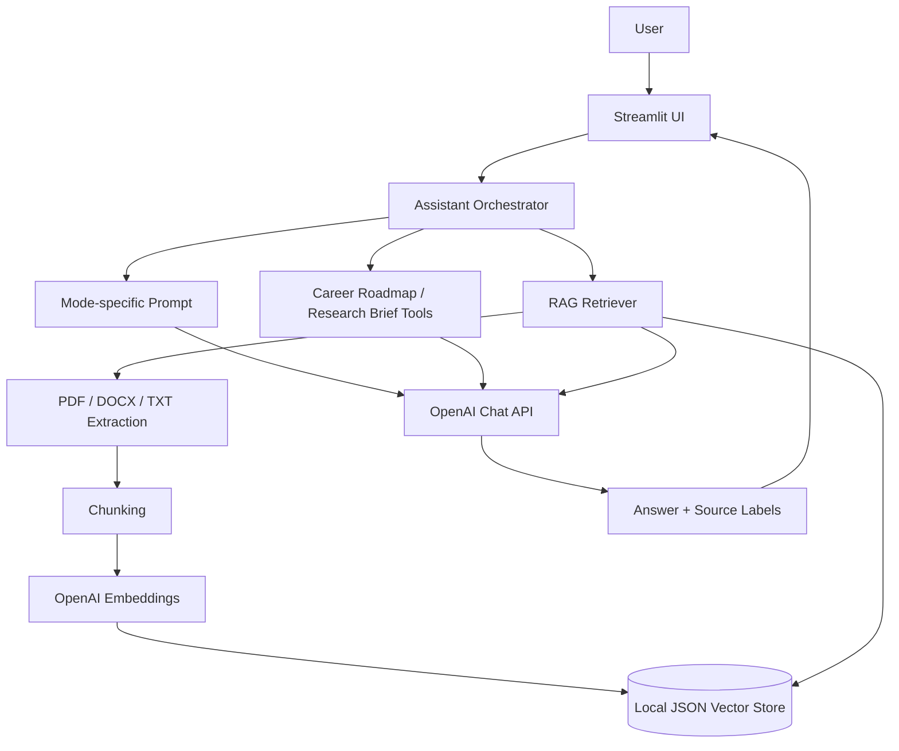

# Architecture

The orchestrator selects a role prompt, optionally routes the task to a helper tool, retrieves relevant document chunks, and sends the assembled context to the OpenAI chat API. Credentials are read from environment variables or Streamlit Cloud Secrets.
